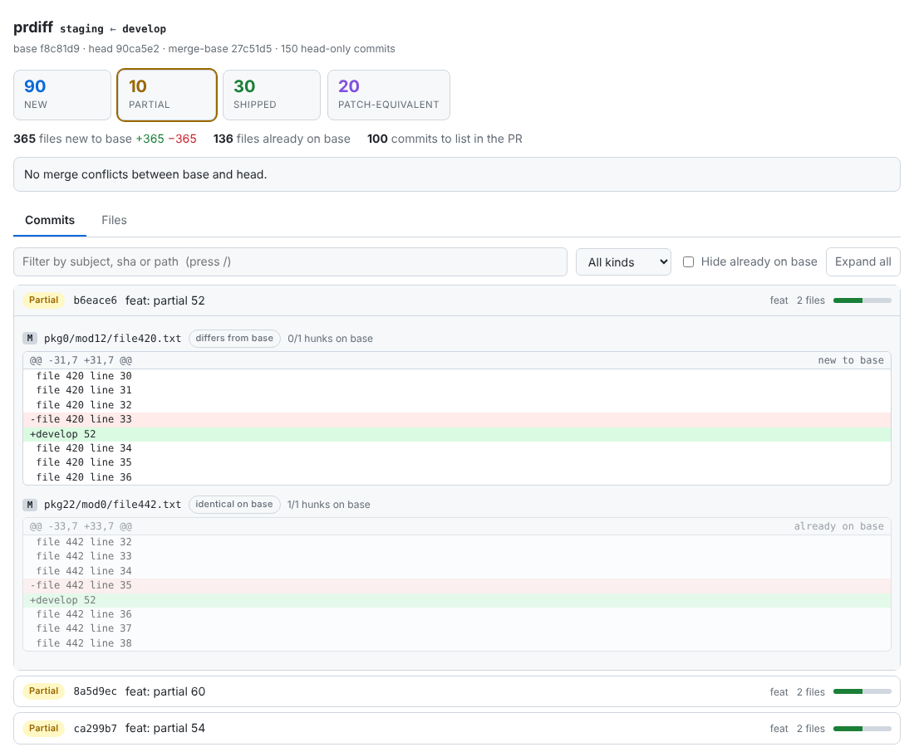
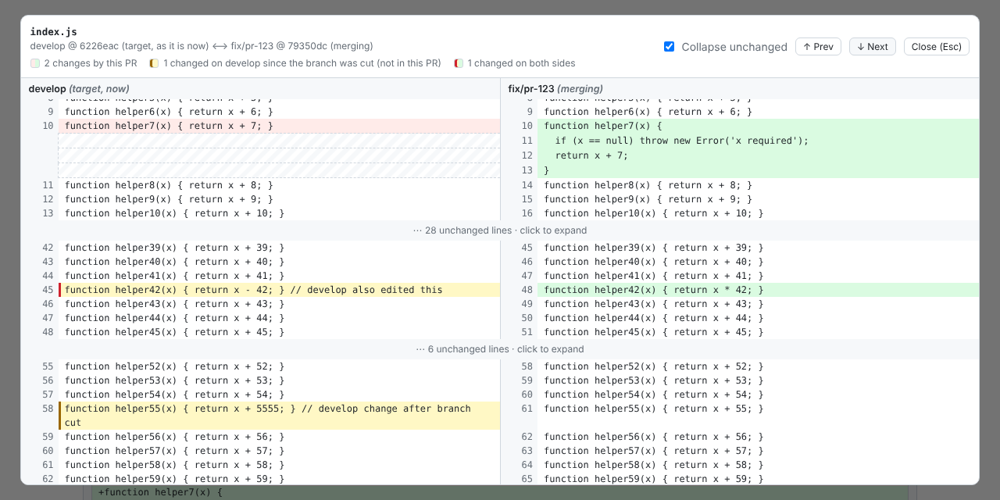

# prdiff

Tells you what **actually** changes when `head` lands on `base`, by content rather than by commit subject.
`git log base..head` over-reports in four common cases (squash merges, cherry-picks, reverts, already-shipped
content), so release PR descriptions list work that is already live. `prdiff` classifies every head-only commit:

| Class | Meaning | Case it fixes |
|---|---|---|
| `NEW` | still has something to ship | |
| `PARTIAL` | some of it is already on base | half-shipped commits |
| `SHIPPED` | its content is already on base (file blobs or hunks) | squash merges, later-edited code |
| `PATCH_EQUIVALENT` | same patch-id exists on base | cherry-picks, backports |

Design: [docs/LLD.md](docs/LLD.md). One static binary; shells out to `git` (2.38+ for exact conflict detection).

## Install

```bash
curl -fsSL https://raw.githubusercontent.com/hokamsingh/prdiff/main/install.sh | sh   # prebuilt binary -> ~/.local/bin
cargo install --git https://github.com/hokamsingh/prdiff                               # from source -> ~/.cargo/bin
brew install hokamsingh/tap/prdiff                                                     # see packaging/homebrew
```

The installer verifies a SHA-256 checksum; pin a release with `PRDIFF_VERSION=v0.2.0`. Prebuilt binaries (Linux x86_64 and
arm64 as static musl builds, macOS Intel and Apple silicon) are published by `.github/workflows/release.yml`, which runs
when a `v*` tag is pushed or from the Actions tab (`gh workflow run release.yml -f version=v0.2.0`). Shell completions:
`prdiff completions zsh`; man page: `prdiff man`.

**While the repository is private**, anonymous downloads return 404, so the `curl | sh` line above does not work. With the
[GitHub CLI](https://cli.github.com) logged in (`gh auth login`), the installer falls back to the REST API by itself:

```bash
gh api repos/hokamsingh/prdiff/contents/install.sh -H 'Accept: application/vnd.github.raw' | sh
```

`cargo install --git` works with whatever git credentials you already use for the repository.

## Commands

With a `prdiff.toml` (or on a repo with an `origin/HEAD`), `--base` and `--head` are optional: head defaults to the
current branch, base to the remote's default branch.

| Command | What it does |
|---|---|
| `compare` | Classify commits, net diff per file, conflicts. `--format text|json|markdown|slack` |
| `describe` | PR description generated from the report (`--format markdown\|slack\|json`) |
| `notes` | Release notes by kind: breaking changes first, `(#123)` and ticket links |
| `view` | One offline HTML report (below). `--serve` for a live local page |
| `where <rev\|#123>` | Which environments already have this commit (merged, cherry-pick, same content, partial, not yet) |
| `matrix` | Every head-only commit against every environment: the release train |
| `rewritten` | What changed between the old and new version of a force-pushed branch (via `git range-diff`) |
| `conflicts` | Files that would conflict, without touching the worktree; who touched each on both sides |
| `check` | CI gate: exit 5 if a PR description lists stale commits or omits new ones |
| `publish --pr N` | Write the description into the PR body (between markers) or as one sticky comment |

```bash
prdiff compare   --base origin/staging --head origin/develop
prdiff describe  --base origin/staging --head origin/develop --title "release: develop to staging" > body.md
prdiff notes     --base origin/production --head origin/staging --ticket-url 'https://jira.example.com/browse/{id}'
prdiff matrix    --head origin/develop --env production=origin/production --env staging=origin/staging
prdiff where '#4821' --env production=origin/production --env staging=origin/staging
prdiff view      --base origin/staging --head origin/develop --open
prdiff publish   --pr 123 --mode comment
```

Useful flags: `--path 'src/**'` and `--exclude '**/*.lock'` (repeatable), `-w` (ignore whitespace-only changes),
`--strict` (PARTIAL counts as NEW), `--shallow` (skip hunk analysis for NEW commits), `--patch-id-scope auto|all|base-only`,
`--pr N`, `--no-owners`, `--no-cache`, `--exact-conflicts`, `-v` (stage timings), `-C <dir>`, `--config <file>`.

Exit codes: `0` ok, `2` bad input (unknown ref, no merge base, bad config, usage), `3` git or `gh` failed (incl. shallow
clone), `4` conflicts with `--fail-on-conflict`, `5` `check` found a stale or incomplete description.

## Configuration: `prdiff.toml`

```toml
base = "origin/staging"          # defaults for --base / --head
head = "origin/develop"
paths = ["src/**"]               # only consider these
exclude = ["**/Cargo.lock", "**/*.snap"]   # left out of file lists and stats (commits are still classified)
risky = ["infra/**", "billing/**"]         # extra files to flag
ignore_whitespace = false

[[environments]]                 # the release train, furthest along first
name = "production"
ref = "origin/production"
[[environments]]
name = "staging"
ref = "origin/staging"

[notes]
repo_url = "https://github.com/acme/app"
ticket_url = "https://jira.example.com/browse/{id}"
```

## `prdiff view`

One offline HTML file (`prdiff-report.html`, or `--out <file>`; `--out -` for stdout). Light and dark themes; commit text
is embedded as JSON and rendered with `textContent`, so a hostile subject line cannot inject markup.

- **Commits**: class chips you can click to filter, an "already on base" bar per commit, colour-coded hunks with the
  ones already on base dimmed.
- **Files**: new to base vs already on base, the commits behind each file, **risk badges** (migrations, lockfiles,
  dependency manifests, deploy config, secrets, files over 500 changed lines, files touched by 5+ commits or 3+ authors,
  plus your `risky` globs), and CODEOWNERS owners with an owner filter.
- **Side by side** on every changed file: the file as it is **now on the target branch** (left) against the **merging
  branch** (right), lines aligned, collapsed unchanged runs, prev/next change, `Esc` to close. The merge-base is used as
  a third copy: red/green = changed by this PR, **amber** = changed on the target since the branch was cut (not part
  of this PR), **amber with a red edge** = changed on both sides, where a manual merge is likely.
- **Conflicts**: a banner naming, per file, the commits on each side that touched it.
- **Train** (with `--env`): each commit against each environment.
- **Rewritten** (with `--old <ref>`): old vs new version of a force-pushed head, with the diff between the two.

Binary files get no side-by-side viewer; files over 512 KB per side, or past `--max-embed-mb` (default 8), get a note
with the `git diff` command. `--no-sides` leaves file contents out. `--serve [--port N]` serves the page on localhost
and reloads it when base or head moves (after a `git fetch`, say).




## GitHub

`--pr N` (any command) and `publish` use the [GitHub CLI](https://cli.github.com); `gh` brings its own auth.

```yaml
# .github/workflows/prdiff.yml
on: pull_request
permissions: { contents: read, pull-requests: write }
jobs:
  prdiff:
    runs-on: ubuntu-latest
    steps:
      - uses: actions/checkout@v4
        with: { fetch-depth: 0 }
      - uses: hokamsingh/prdiff@main
        with: { mode: comment }      # check | body | comment | summary
```

`body` replaces only the block between `<!-- prdiff:start -->` and `<!-- prdiff:end -->`; `comment` finds its own
comment by marker and edits it in place; `check` fails the job when the description disagrees with the report.
The action and the release workflow have not been run on GitHub yet (see Status).

## How it differs from the LLD

- **Hunk analysis runs on NEW commits too** (default), so a change base later edited around is not called new.
  `--shallow` restores the LLD behaviour. Hunks are matched in memory against the base blob; replacement hunks whose
  surrounding context drifted are still recognised by their own lines.
- **Cherry-pick search is path-set prefiltered and cached** per commit SHA in `.git/prdiff/commits`. The default scope is
  base commits newer than the oldest head-only commit (minus 2 days), which also catches backports merged back into head.
- **Conflict detection** first proves the two sides are disjoint (no shared path, no file/dir clash, no add-vs-delete
  pair) and skips `git merge-tree`; otherwise it runs against a throwaway object directory (tmpfs on Linux), so the
  repository is never written to. A randomized test checks the shortcut against `merge-tree` on 120 histories.
- **Stage D logic**: the LLD says a hunk is on base when its reverse fails to apply; it is the opposite (the reverse
  applies cleanly when the change is present).

## Performance

Synthetic monorepo-shaped history (`scripts/gen_bench_repo.py`): 150 head-only commits touching ~500 files, mixing squash
merges, cherry-picks, half-shipped commits and base-side edits, with a couple of real conflicts. 4 vCPU Xeon @ 2.1 GHz,
git 2.43, medians:

| Base history | `git log base..head` | `git cherry` | `prdiff compare` cold | warm |
|---|---|---|---|---|
| 2,376 commits | 7 ms | 29 ms | 230 ms | 180 ms |
| 21,296 commits | 11 ms | 93 ms | 434 ms | 280 ms |
| 104,211 commits | 24 ms | 189 ms | 694 ms | 431 ms |

On all three, the counts match what the generator built in (90 NEW, 10 PARTIAL, 30 SHIPPED, 20 PATCH_EQUIVALENT).
Time is spent in `git` subprocesses; the Rust side is under a millisecond. Reproduce:
`python3 scripts/gen_bench_repo.py /tmp/b 20000 1500 && scripts/bench.sh /tmp/b`.

## Status

`cargo test` runs 61 tests against fixture repos built with the real `git` binary (golden JSON, CLI exit codes, a fake
`gh`, a local `file://` release for `install.sh`, a randomized conflict check). CI runs them with `fmt` and `clippy -D
warnings` on Ubuntu and macOS (git 2.55 and 2.56 there; development used 2.43) and is green. CI already caught one real
macOS bug (`\b` is not supported in POSIX regex, which broke `where '#123'`).

**Not run against the real thing:** the GitHub integration (`--pr`, `publish`) was tested against a fake `gh` only;
`action.yml` and the Homebrew formula have never run. `release.yml` ran once (v0.2.0: four builds, checksums, release),
and `install.sh` was run against that real release on Linux x86_64 through its `gh` fallback (the repository is private);
the anonymous `curl | sh` path, macOS, arm64 and Homebrew installs are untested.

## Limits

- Equivalence is by patch and content, not behaviour: a rewritten function is NEW.
- Hunk matching is a contiguity check, not a full `git apply`; pure additions or deletions whose context changed are
  conservatively reported as not on base. The conflict-attribution marker treats "target changed a line the PR deleted"
  as target-only.
- Merge commits are skipped (their changes appear in their parents). Paths containing newlines are treated as "differs".
- `rewritten` relies on `git range-diff` pairing; heavily reworked commits can show as dropped + added.
